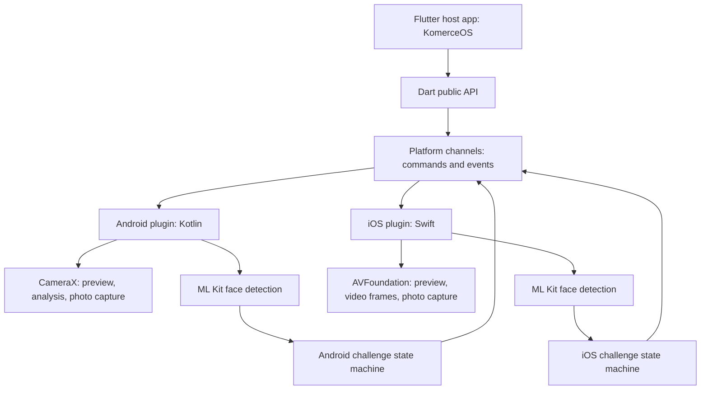

# Flutter Liveness SDK

A planned Flutter plugin for guided face-action verification on Android and iOS.

> **Status: design and implementation plan.** This repository currently contains documentation only. The API, platform code, example app, and releases described below do not exist yet.

The first consumer is [KomerceOS](https://github.com/nunutech40). The Android implementation will start from the existing [android-liveness-sdk](https://github.com/nunutech40/android-liveness-sdk); the iOS implementation will be written in Swift in this repository. Once ported, this plugin will own both implementations. KomerceOS will install one Flutter package and will not need a JitPack dependency for liveness.

## Goals and scope

- Offer the same Dart API and user-facing challenge flow on Android and iOS: look left, look right, smile, and blink.
- Keep camera frames and face analysis on the native side. Send configuration, progress, errors, and file references across Flutter channels.
- Support a lower-cost analysis profile for slower devices without silently weakening the verification criteria.
- Produce a final selfie and optional per-step evidence, with documented orientation, format, and lifecycle.
- Handle camera permission, cancellation, timeout, app lifecycle changes, and recoverable failures predictably.
- Keep this plugin usable independently of KomerceOS while validating it against KomerceOS before release.

This is **challenge-based face-action verification**. Face detection and completing actions do not by themselves prove resistance to printed photos, replayed video, masks, or injected camera frames. Do not describe the SDK as certified presentation attack detection or use a local `success` flag as the sole basis for a high-stakes identity decision. Attack testing and any stronger anti-spoofing controls are separate release criteria.

## Repository strategy

This is **one repository for the new Flutter SDK**, containing Dart, Kotlin, and Swift. The existing Android-only repository remains available to its current native Android consumers. Its source is the starting point for the Android implementation here, not a runtime dependency. During migration, fixes needed by both products must be applied to both repositories; after that, this plugin is the source of truth for its Flutter-facing implementation.

Proposed layout:

```text
flutter-liveness-sdk/
├── lib/
│   ├── flutter_liveness_sdk.dart       # Public Dart API
│   └── src/                            # Models, events, channel adapter
├── android/
│   └── src/main/kotlin/.../            # Flutter bridge, screen, CameraX, ML Kit, rules
├── ios/
│   ├── Classes/                        # Flutter bridge, screen, AVFoundation, ML Kit, rules
│   └── flutter_liveness_sdk.podspec     # Native iOS dependencies and deployment target
├── example/                             # Android/iOS integration app
├── test/                                # Dart API and state-machine tests
└── README.md
```

The generated Flutter plugin layout may vary with the Flutter version; keep the same ownership boundaries if the scaffold uses a newer iOS source layout.

## Architecture



### Flutter/native boundary

| Direction | Data | Planned transport |
| --- | --- | --- |
| Dart → native | Start session with steps, timeout, audit mode, and presentation options; cancel session | `MethodChannel` commands |
| Native → Dart | Ready, current step, guidance, step passed, terminal success/failure | `EventChannel` event stream |
| Native → Dart | Final selfie and optional audit evidence | File paths/URIs in the terminal event; **no camera frames or `Bitmap` objects** |

The public Dart API hides channel details. Channel names, payload versions, event ordering, and error codes will be documented and tested before the first release. Pigeon can replace hand-written payload mapping once the contract is stable; Flutter supports both approaches.

For v1, a **full-screen native capture screen** is preferred. Android can bind its existing `PreviewView` to an Activity lifecycle, and iOS can own an `AVCaptureSession` in a view controller. The Flutter app receives progress and the final result. Embedding the preview as a Flutter platform view can be added later if product design requires Flutter widgets over the camera; it needs separate performance and lifecycle testing.

### Session lifecycle

```text
idle → requestingPermission → initializing → ready → running
                                                ├→ completed
                                                ├→ cancelled
                                                ├→ timedOut
                                                └→ failed
```

A session must produce exactly one terminal result. `cancel()` must stop capture and release native resources. App backgrounding, screen dismissal, camera interruption, and engine detachment must also have defined outcomes. Starting a second session while one is active must fail clearly or cancel the first by explicit policy.

## Proposed Dart API

The following is a **design sketch**, not installable code:

```dart
final result = await FlutterLivenessSdk.capture(
  config: const LivenessConfig(
    steps: [
      LivenessStep.lookLeft,
      LivenessStep.lookRight,
      LivenessStep.smile,
      LivenessStep.blink,
    ],
    auditMode: false,
    timeout: Duration(seconds: 30),
  ),
  onEvent: (event) {
    // Update host UI or analytics from typed progress/error events.
  },
);

if (result.isSuccess) {
  final selfiePath = result.selfiePath;
}
```

The API will expose typed step, progress, error, and result models. A result should include a terminal status, a final selfie path when successful, optional evidence paths keyed by step, and a machine-readable failure code. Temporary file ownership and cleanup behavior must be explicit. The host application decides whether and where to upload the result; the SDK will not upload biometric images itself.

## Platform implementations

### Android

Port and refactor the Kotlin logic from [android-liveness-sdk](https://github.com/nunutech40/android-liveness-sdk) into this plugin. It currently uses CameraX, bundled ML Kit Face Detection, and Kotlin thresholds/state transitions. The current “low-end” check (`ActivityManager.isLowRamDevice` or RAM below 2 GB) still uses ML Kit: it selects `FAST` and reduces analysis resolution to 480×640. That threshold is an initial heuristic, **not a published ML Kit hardware minimum**.

Before shipping the port:

- Make camera initialization asynchronous and observable; never silently return from `start` while the provider is still loading.
- Separate low-resolution analysis from final still capture so the final selfie quality is not determined by the analysis stream.
- Require meaningful action transitions across frames rather than accepting one threshold-crossing frame; define blink using an open → closed → open transition.
- Implement timeout, cancellation, error propagation, and detector/camera cleanup.
- Test front-camera mirroring, orientation, face size, and the wording of left/right prompts on real devices.

The host's Android `minSdk` is 24 (Android 7.0) for this SDK. KomerceOS currently resolves `flutter.minSdkVersion` to 24. `compileSdk` and `targetSdk` are separate build/behavior settings and do not raise the minimum installable OS. The host must declare `android.permission.CAMERA` and request it at runtime.

### iOS

Build the iOS engine in `ios/Classes/` with Swift, AVFoundation camera capture, and Google ML Kit Face Detection. Match the Dart-facing states, challenges, error codes, output format, and cancellation behavior of Android. Keep thresholds and coordinate conventions platform-specific where the detectors differ; verify parity with the same test scenarios rather than copying numeric thresholds blindly.

The planned ML Kit iOS dependency requires **iOS 15.5+ on 64-bit devices**. KomerceOS currently targets iOS 15.0, so integration requires updating both the Podfile and Xcode deployment target to at least 15.5. The host must add `NSCameraUsageDescription` to `Info.plist`. The plugin podspec will declare its native dependency; the consumer should not manually copy Swift files into `Runner`.

Apple Vision is a possible alternative if preserving iOS 15.0 becomes a firm requirement. It would be a separate detector implementation with different face signals and calibration work. It is not the v1 plan.

## Device and performance policy

**OS compatibility is not a performance guarantee.** There is no defensible universal minimum RAM or exact model list yet. A weak device may complete the flow in `FAST` mode; another device with the same RAM may have a worse camera or thermal behavior. The SDK should measure actual analysis latency and recover gracefully when a session cannot meet its quality or time limits.

Initial validation matrix:

| Class | Minimum scenario to test |
| --- | --- |
| Android OS floor | API 24 device with a front camera |
| Android low-end | Approximately 2 GB RAM and `isLowRamDevice` devices, including slow camera hardware |
| Android mainstream | Mid-range and high-end devices across current supported OS versions |
| iOS OS floor | iOS 15.5 on the oldest practical supported iPhone and iPad models |
| iOS mainstream | Recent iPhones and iPads, including camera interruption and app backgrounding |

Record processed frame latency, completion and timeout rates, detector failures, memory use, crash/OOM events, thermal degradation, photo quality, and false accept/reject outcomes. Define acceptance thresholds from real measurements before claiming support for a device class. If a device cannot complete verification reliably, return a clear failure/retry path; do not silently switch to an unvalidated weaker check.

Google recommends `FAST` mode, appropriate input resolution, and dropping/throttling frames for real-time face detection. Face size within the frame matters as much as raw resolution.

## Installing in KomerceOS (after the first release)

This package is **not installable yet**. Once tagged, KomerceOS can pin a release in `pubspec.yaml`:

```yaml
dependencies:
  flutter_liveness_sdk:
    git:
      url: https://github.com/nunutech40/flutter-liveness-sdk.git
      ref: v1.0.0
```

Then run `flutter pub get` and perform a full native rebuild. Android source and dependencies compile from this plugin; no JitPack repository is required for the copied Android implementation. iOS Swift and its ML Kit pod are resolved through the plugin's podspec. Before the app can run capture, KomerceOS must add the camera permission declarations, update its iOS deployment target to 15.5, and include the feature's consent/UX copy.

For local development, a relative `path:` dependency can point KomerceOS to a neighboring checkout of this repository. Publish to pub.dev only after the API and native integration are stable.

## Implementation plan

1. **Scaffold** a Flutter plugin for Android and iOS with an example app; set compatible Dart/Flutter constraints for KomerceOS's pinned toolchain.
2. **Define the contract**: typed config, progress, terminal results, error codes, file lifecycle, and channel payloads.
3. **Port Android** source into the plugin, remove JitPack coupling, improve camera readiness, capture quality, lifecycle, and low-end handling.
4. **Implement iOS** capture and challenge flow in Swift with the same public contract.
5. **Validate behavior** on the device matrix, including poor lighting, multiple/no faces, permission denial, interruption, timeout, cancel, replay attempts, and repeated sessions.
6. **Integrate KomerceOS** in a feature branch; verify Android and iOS builds, permissions, minimum OS settings, and the complete business flow.
7. **Release** a tagged version with API reference, changelog, sample app, and known limitations.

A v1 release requires successful native builds on both platforms, one terminal outcome per session, no camera/resource leaks across repeated attempts, acceptable measured performance on the declared device matrix, and documentation that matches the implemented behavior.

## References

- [Existing Android SDK](https://github.com/nunutech40/android-liveness-sdk)
- [Flutter: developing plugins](https://docs.flutter.dev/packages-and-plugins/developing-packages)
- [Flutter: platform channels and Pigeon](https://docs.flutter.dev/platform-integration/platform-channels)
- [Flutter: Git and path dependencies](https://docs.flutter.dev/packages-and-plugins/using-packages)
- [Google ML Kit: Android face detection and real-time guidance](https://developers.google.com/ml-kit/vision/face-detection/android)
- [Google ML Kit: iOS face detection and real-time guidance](https://developers.google.com/ml-kit/vision/face-detection/ios)
- [Google ML Kit: iOS compatibility prerequisites](https://developers.google.com/ml-kit/migration/ios)
