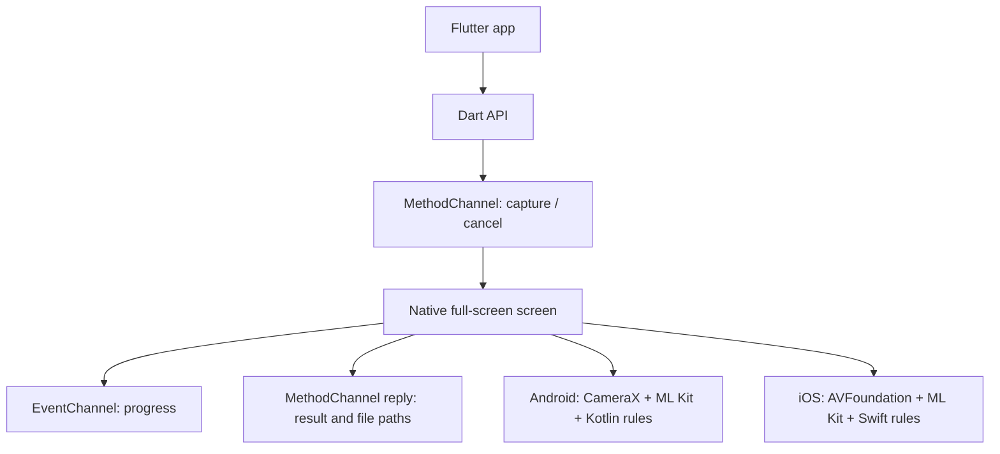

# Flutter Liveness SDK

A Flutter plugin for guided face-action capture on Android and iOS. It uses one repository for the Dart API, Kotlin implementation, and Swift implementation. The first planned consumer is KomerceOS.

**Status: initial implementation (0.1.0), not yet validated on physical devices.** The package contains native capture screens and a working Dart contract. Android debug and iOS device builds pass; real-device calibration remains a release gate. Do not use this version as the sole control for high-stakes identity decisions.

This is challenge-based face-action verification. It does not establish resistance to printed photos, replayed video, masks, or camera injection. ML Kit detects facial features; it is not an anti-spoofing verdict.

## Requirements

| Platform | Minimum | Native stack |
| --- | --- | --- |
| Android | API 24 (Android 7.0), front camera | CameraX 1.4.2, ML Kit Face Detection 16.1.7 |
| iOS | iOS 15.5, 64-bit, front camera | AVFoundation, Google ML Kit Face Detection 9.x |
| Flutter | 3.41.0 / Dart 3.11.0 | MethodChannel and EventChannel |

The minimum OS is an installation requirement, not a promise that all devices at that OS floor can finish reliably. Android low-RAM devices still use ML Kit in `FAST` mode with 480×640 analysis; iOS devices with under 2 GB RAM use ML Kit `FAST` mode. Both keep the same challenge rules. There is no separate unvalidated algorithm fallback.

KomerceOS currently resolves Android `minSdk` to 24 and targets iOS 15.0. **Its iOS Podfile and Xcode deployment target must be raised to 15.5** before adding this plugin. This also removes support for any device that cannot run iOS 15.5. Check product analytics and your supported-device policy before shipping that app change.

## Install

Until a tested release tag exists, use a pinned Git commit or a sibling checkout:

```yaml
# pubspec.yaml
dependencies:
  flutter_liveness_sdk:
    git:
      url: https://github.com/nunutech40/flutter-liveness-sdk.git
      ref: <tested-commit-sha>
```

For local KomerceOS development:

```yaml
dependencies:
  flutter_liveness_sdk:
    path: ../flutter-liveness-sdk
```

Run `flutter pub get` and rebuild the native app. The Android source and iOS Swift code are included in this plugin; consumers do not install the old Android SDK or copy Swift files. The plugin's Android manifest declares camera permission and the native Activity. The host app must set `NSCameraUsageDescription` in `ios/Runner/Info.plist`:

```xml
<key>NSCameraUsageDescription</key>
<string>Camera access is needed to verify face actions and capture a selfie.</string>
```

Set the host iOS deployment target to 15.5 in both `ios/Podfile` and `Runner.xcodeproj`. The plugin requests camera permission at runtime. If you need pre-capture consent or an explanation screen, implement that in the host app.

## Usage

```dart
import 'package:flutter_liveness_sdk/flutter_liveness_sdk.dart';

final subscription = FlutterLivenessSdk.events.listen((event) {
  // event.type: ready, guidance, or stepPassed
  // event.step / event.code: current action or guidance code
});

try {
  final result = await FlutterLivenessSdk.capture(
    LivenessConfig(
      steps: [
        LivenessStep.lookLeft,
        LivenessStep.lookRight,
        LivenessStep.smile,
        LivenessStep.blink,
      ],
      auditMode: true,
      timeout: const Duration(seconds: 30),
    ),
  );
  if (result.isSuccess) {
    final selfiePath = result.selfiePath!;
    final perStepEvidence = result.evidencePaths;
    // Your app decides whether to retain or upload the images.
  } else {
    final status = result.status;
    final reason = result.errorCode;
  }
} finally {
  await subscription.cancel();
}
```

Call `await FlutterLivenessSdk.cancel()` to end the active session. Only one capture session can run at once. Invalid config or no foreground Activity/view controller returns a `PlatformException`; camera failures, denial, timeout, and user cancellation return a terminal `LivenessResult`. The `events` stream is informational. The `capture` future is the authoritative terminal result.

`LivenessResult` contains `status` (`success`, `cancelled`, `timedOut`, `failed`), `selfiePath` on success, optional `evidencePaths` keyed by step, and an optional machine-readable `errorCode`. Image paths point to the app's temporary/cache directory. Copy or upload needed images promptly and delete them under your app's biometric-data retention policy. The SDK itself does not upload images.

## Architecture



The native screen owns the camera. It keeps raw frames native and sends only low-volume events and file paths through Flutter channels. Android uses `ImageAnalysis` for actions and `ImageCapture` for the final still. iOS uses `AVCaptureVideoDataOutput` for actions and `AVCapturePhotoOutput` for the final still. Both require an initial neutral pose before a turn or smile, an open → closed → open blink, and a near-frontal pose for the final photo. Each platform has its own state machine because ML Kit coordinate and probability behavior must be calibrated per device.

Channel names are implementation details: `com.nunutech40.flutter_liveness_sdk/commands` and `/events`. Host apps should use the Dart API. Android's `LivenessActivity` and iOS's `LivenessViewController` are internal.

## Android source reference

The Android implementation was designed against [android-liveness-sdk at `29d8a95`](https://github.com/nunutech40/android-liveness-sdk/tree/29d8a95e6fe10e58d459a9caf40fd94fd8de7f6e), particularly its [public API](https://github.com/nunutech40/android-liveness-sdk/blob/29d8a95e6fe10e58d459a9caf40fd94fd8de7f6e/src/main/java/com/komerce/liveness/api/LivenessDetector.kt), [CameraX and ML Kit service](https://github.com/nunutech40/android-liveness-sdk/blob/29d8a95e6fe10e58d459a9caf40fd94fd8de7f6e/src/main/java/com/komerce/liveness/internal/MLKitFaceService.kt), [challenge analyzer](https://github.com/nunutech40/android-liveness-sdk/blob/29d8a95e6fe10e58d459a9caf40fd94fd8de7f6e/src/main/java/com/komerce/liveness/internal/FaceAnalyzer.kt), and [low-RAM policy](https://github.com/nunutech40/android-liveness-sdk/blob/29d8a95e6fe10e58d459a9caf40fd94fd8de7f6e/src/main/java/com/komerce/liveness/internal/DeviceUtils.kt). Its native API is not a dependency of this Flutter plugin.

This plugin gives the capture screen ownership of permission and camera startup, reports initialization errors, adds timeout and cancellation, requires multi-frame action transitions, checks both eyes for blink, and captures a separate final still. The upstream Android-only SDK remains unchanged for its existing users. Apply any future fixes deliberately to both codebases where relevant.

## Release gates and current limitations

- Android example debug APK and iOS device app (without code signing) built successfully on 2026-10-25. `flutter analyze`, Dart/widget tests, and Android Kotlin challenge tests passed. The Apple Silicon iOS 26 simulator build is blocked by ML Kit 9.x binary slices, so use a physical iPhone for camera validation.
- Test on physical front cameras: Android API 24, an approximately 2 GB low-RAM Android device, a mainstream Android device, an iOS 15.5 device, and a current iPhone. Verify left/right wording, image orientation, blink/smile thresholds, timeout, cancellation, interruption, and image quality.
- Measure frame latency, memory, thermal impact, crash/OOM rate, false accepts and rejects, and completion rate before claiming support for low-end devices.
- Perform presentation-attack testing if your product needs stronger assurance. This plugin has no server validation, active depth check, or certified presentation attack detection.
- The UI copy is currently English and the native screen is not yet themeable. Accessibility, localization, camera interruption behavior, and temporary-file cleanup policy need product review.

## Development

```bash
flutter pub get
flutter analyze
flutter test
cd example
flutter build apk --debug
flutter build ios --no-codesign
flutter run -d <device-id>  # open the Test Lab on a physical device
```

The [example Test Lab](example/README.md) lets you configure actions, audit mode, and timeout, then inspect progress events, results, and photos. It runs within this library repository; KomerceOS is not needed for testing. The ML Kit 9.x pods used here do not include an arm64 iOS simulator slice; an Apple Silicon iOS 26 simulator build fails at link time. Device builds use the supported arm64 iOS slice. See [LICENSE](LICENSE) for Apache 2.0 terms.
